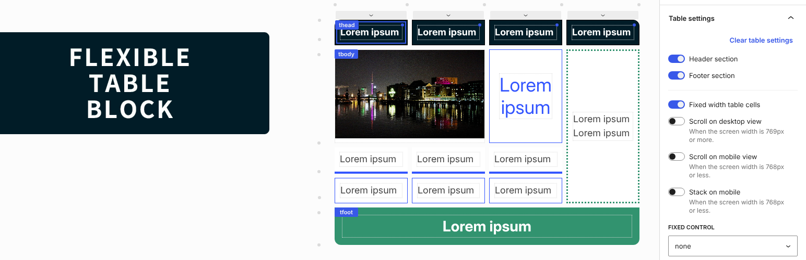
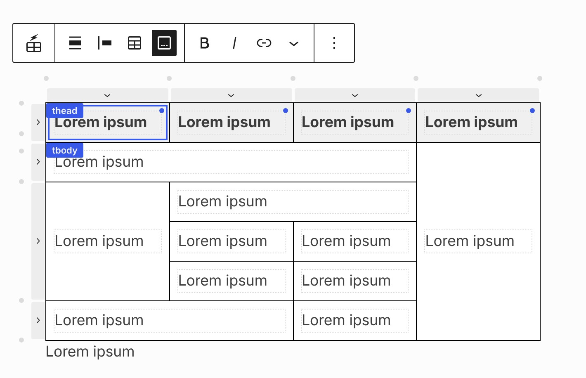
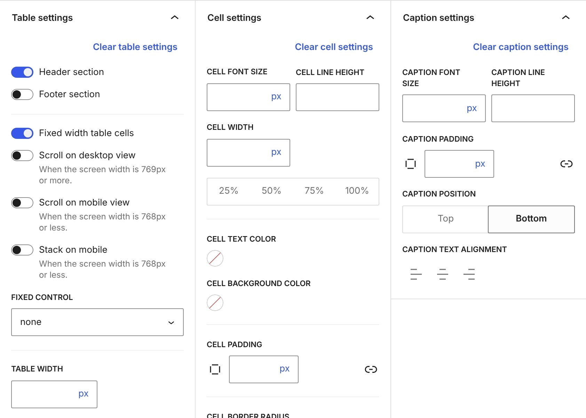
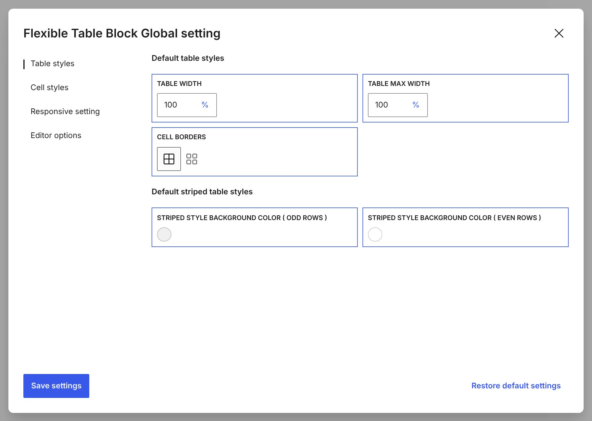
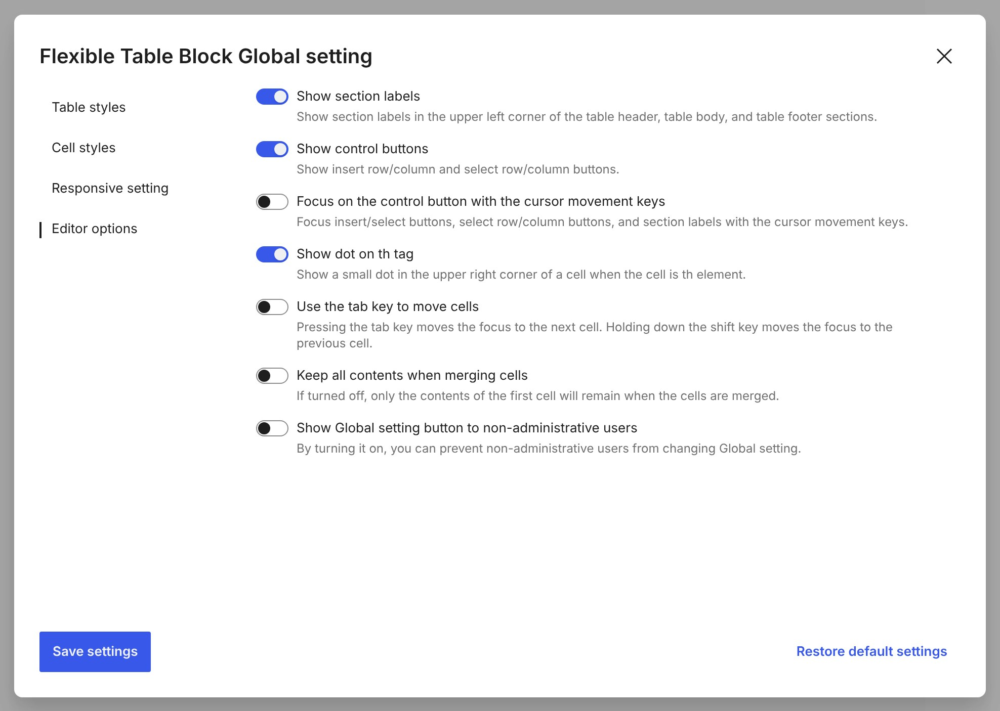

# Flexible Table Block

[](https://github.com/t-hamano/flexible-table-block/actions/workflows/test.yml)
[](https://github.com/t-hamano/flexible-table-block/actions/workflows/deploy.yml)



Flexible Table Block is a custom block plugin for the WordPress block editor that allows you to create tables in any configuration.

## Features

### Merge Cells and Intuitive Selection



You can merge or split cells from multiple selected cells. You can also easily select a batch of cells in a section, or select, add, or delete rows and columns with the buttons.

### Flexible Styling and Responsive Support



You can set various styles for each tag of table, cell, and caption individually. You can also set the table to scroll horizontally on both desktop and mobile, and arrange cells vertically on mobile. The breakpoint for switching between desktop and mobile can be changed freely.

### Global Default Styles



You can set the default styles of tables and cells for the entire site.

### Editor Options



You can change the editor behavior, such as showing section labels and control buttons, or moving between cells with the tab key.

## How to build

```sh
npm install
npm run build
```

## Resources

### Image for banner

- License: CC BY 2.0
- Author: mripp
- Source: <https://openverse.org/image/5438640e-83e1-4759-8691-1f87086fd651>

## Author

[Aki Hamano (Github)](https://github.com/t-hamano)
